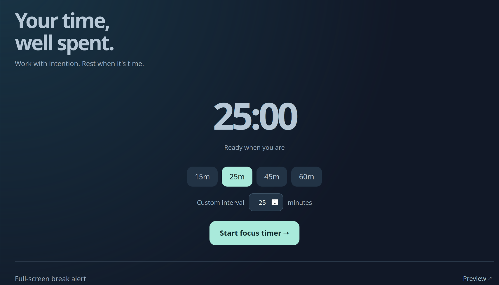

# Break Reminder

A lightweight desktop break timer built with React and Python (`pywebview`).



The application has a compact timer interface with selectable work intervals. When the timer expires, the window expands into a fullscreen reminder. Users can snooze, dismiss the reminder, or start another session.

## Installation (Ubuntu)

Install the required system packages:

```bash
sudo apt install python3-venv python3-gi python3-gi-cairo gir1.2-gtk-3.0 gir1.2-webkit2-4.1
```

Create a Python environment and install `pywebview`:

```bash
/usr/bin/python3 -m venv --system-site-packages .venv
.venv/bin/pip install pywebview
```

## Run

From the project directory:

```bash
.venv/bin/python app.py
```

Select a work interval and start the timer. Use **Preview** to test the fullscreen reminder. Press **Esc** to close it.
